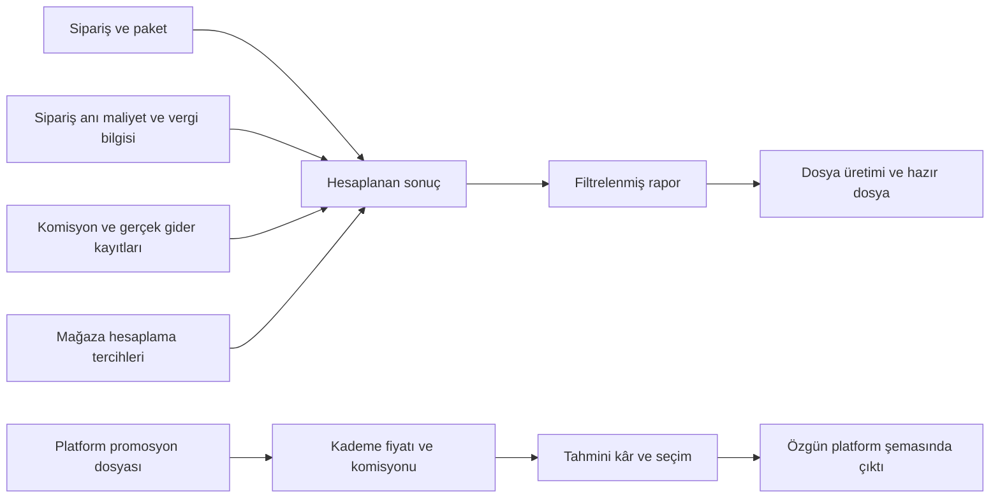

# Melontik — giriş yapılmış hesapta işlev incelemesi

Tarih: 8 Kasım 2026. Önceki rapor: [sayfa karşılaştırması](MELONTIK-KARSILASTIRMA.md).
Bu teslimat yalnız inceleme içerir; uygulama kodunda değişiklik yapılmadı.

**Giriş tamamlandı ve 32 müşteri ekranı/adresi üyelik oturumuyla açıldı.**
Pazar Zekası ekranları bu oturumda görülebiliyor. Partner adresi yine Dashboard'a
yönleniyor. Ekrana erişmek, içindeki bütün işlevlerin kabul testinden geçtiği
anlamına gelmiyor.

## Gerçekten ne doğrulandı?

Sayfa açılışları, arama/filtre/temizleme kontrolleri, toplu seçim alanlarının
kurulumu, rapor detay ve indirme girişleri, fiyat düzenleme arayüzünün açılması
ve ayar sekmeleri denendi. Düğme tıklaması, DOM/alan değişimi ve gözlenen istekler
ayrı kaydedildi. Değişiklik görülmeyen tıklamalar otomatik olarak başarılı sayılmadı.

Aynı sipariş satırında tekrarlanan `Detaylar` ve ürün satırındaki `Güncelle`
gibi düğmeler ayrı işlev türü olarak incelenir; yüzlerce satırın her birinin
tek tek çalıştırıldığı iddia edilmez. Kontrol envanteri, hangi türün denendiğini
ve hangisinin yalnız görüldüğünü açıkça gösterir.

Bu raporda gerçek mağaza/ürün isimleri, barkodlar, müşteri bilgileri, sipariş
numaraları, ciro/kâr tutarları, API bilgileri ve oturum verileri paylaşılmadı.
Hesaptaki özel ekran görüntüleri ve ham yanıtlar GitHub'a eklenmedi.

## Tamamlanamayan testlerin somut nedenleri

| Alan | Gözlenen engel | Tam kabul testi için gereken |
| --- | --- | --- |
| Mağaza / ürün takibi | Deneme süresinin dolduğu ve takip hakkının bulunmadığı bildiriliyor. | Bu modülde etkin erişim/kota ve denenecek mağaza/ürün. |
| Reklam Radarı | Kelime izleme hakkı yok; plan yükseltme isteniyor. | Etkin kelime izleme hakkı ve test kelimesi. |
| Influencer Radarı | Modülün mevcut plana dahil olmadığı bildiriliyor. | Influencer erişimi bulunan plan. |
| Partner paneli | `/partner` Dashboard'a yönleniyor. | Partner paneli yetkisi; yönlendirme sebebi tek başına sayfa açılışından kesinleştirilemez. |
| Promosyon / kampanya tabloları | İlgili platform Excel dosyaları yüklenmemiş; boş tablo/dosya yükleme uyarısı var. | Gerçek şemada örnek dosyalar ve kaydedilecek test seçimleri. |
| Kalıcı ürün / fiyat değişikliği | Gerçek mağaza verisini etkileyebilir. | Kullanıcının belirlediği test ürünü, işlem kapsamı ve geri dönüş değerleri. |
| Ödeme / abonelik satın alma | Gerçek ücret doğurur. | Ayrı satın alma talimatı veya sağlayıcının test ödeme ortamı. |

Yeni takip, ücretli erişim, kampanya başlatma, ürün arşivleme, fiyat/maliyet
kaydetme ve hesabın API bilgilerini değiştirme işlemleri yapılmadı. Bir formun
açılması bu işlemlerin uçtan uca test edildiği şeklinde raporlanmadı.

## Bizim projede ek olarak kanıtlanan kritik promosyon hataları

### Fiyat kademesinin komisyonu kullanılmıyor

İzole test veritabanında, tek barkod ve aynı 400 TL satış fiyatıyla iki kademe
oluşturuldu. Birinci kademenin komisyonu %5, ikincinin %25 olarak dosyaya yazıldı.
Bizim analiz iki kademede de **32,13 TL** kâr verdi. Ürün kartındaki aynı komisyon
oranını iki kez kullandı; dosyadaki kademe komisyonlarını okumadı.

Aynı test ürününde komisyon oranları hesap motoruna ayrı verildiğinde sonuçlar
%5 için **86,67 TL**, %25 için **20,00 TL** oluyor. Bu fark CSV okuyucunun kademe
komisyonunu hesap girdisine taşımadığını gösterir. Kaynak:
`public_html/promosyon-analiz.php` içindeki `calc_product_profit($p, $price)` çağrısı.

Bu test sentetik verilerle yalnız bizim uygulamada yapıldı; Melontik hesabına
dosya yüklenmedi. Melontik'in aynı dosyadaki sayısal sonucunu görmeden onun
hesabının bu örnekte doğrulandığı iddia edilmez.

### İndirilen dosya özgün platform şemasını korumuyor

Aynı testte çıktı başlığı şu alanlara dönüştü:
`barkod, urun_adi, maliyet, kademe_fiyati, kademe_net_kar, secim`.
Girişteki komisyon kolonları çıktıdan kayboldu. Çıktı, platformun özgün Excel
şablonu değil, yeni üretilmiş bir CSV özeti. Dolayısıyla “indir ve Trendyol'a geri
yükle” akışı gerçek platform dosyasıyla kabul edilmeden tamamlanmış sayılamaz.

Özgün sütun sırası, hücre tipleri, barkodların metin olması, komisyon aralıkları,
teklif dönemi ve seçim alanları için modül bazlı dosya sözleşmeleri gerekiyor.

## Çalışma mantığından çıkarılan gereksinimler

| Özellik | Gözlenebilen mantık | Bizim projede gerekli değişiklik |
| --- | --- | --- |
| Dashboard | Maliyeti olan ciro ile toplam ciro ayrılıyor; brüt kârdan reklam/ceza/erken ödeme/diğer kesintilerle net sonuca geçiliyor. | Ürün bazlı tahmin ile finans kayıtlarına dayalı sonuç için ayrı kaynaklar ve toplamlar. |
| Sipariş raporları | Açılan detay paneli maliyeti sipariş tarihinde geçerli ürün ayarından, komisyonu siparişten gelen kayıttan aldığını açıklıyor; eksik maliyet ayrıca ele alınıyor. | Sipariş anı maliyet/gider görüntüsü; güncel kartın eski kârı değiştirmemesi. |
| Promosyon | Modüle ait dosya, dönem ve fiyat/komisyon kademeleri; bunların üzerinde seçim ve indirme. | Tek genel fiyat kolon tarayıcısı yerine modül bazlı veri modeli ve özgün dosya gidiş-dönüşü. |
| Toplu seçim | Önce bir fiyat kademesi seçiliyor; seçim kuralı o kolona uygulanıyor. | Barkod bazlı tek seçim yerine ürün + kademe + dönem anahtarı ve açık seçim kuralı. |
| Fiyatlandırma | Kâr tutarı, maliyet üzerinden oran ve satış üzerinden marj farklı hedefler. KDV kalemleri ayrıca gösteriliyor. Sipariş detayının açıklamasına göre negatif net KDV tercihi genel ayarlardan değiştirilebiliyor. | Ayrı gider KDV oranları, negatif net KDV/mahsubun anlamı ve açık kuruş yuvarlama politikası. Önceki rapordaki farklar giderilmeli. |
| Rapor indirme | İndirme penceresinde Dosyayı Oluştur ile işlem başlatılıyor; Tabloyu Güncelle sonrasında hazır rapor için Dosyayı İndir bağlantısı görülüyor. | Büyük veri için rapor üretim durumu, hazır dosya kaydı, yetkili indirme ve hata takibi. |
| Ürün ayarları | Maliyet/KDV/desi/teslimat/ek gider ve eşleştirme bilgileri hesaplamanın girdisi. | Varyant alanları, pazaryerleri arası eşleştirme ve sürümlü maliyet politikası. |
| Pazar Zekası | Tek bir liste yerine mağaza, ürün, reklam kelimesi, bildirim ve influencer modülleri ayrı; erişim ve kotalar kontrol ediliyor. | Modül bazlı abonelik/kota, tarama işleri, tarihsel veri ve bildirim kuralları. Takip motorunun doğruluğu ayrıca veriyle test edilmeli. |
| Hakediş / desi | Satış toplamı kıyasından daha geniş; fazla kargo, eksik iade komisyonu ve eksik satış bedeli ayrı kontroller. | Paket/fatura/ödeme kimlikleriyle mutabakat ve denetlenebilir fark kayıtları. |

Bunlar arayüz, yardım belgeleri, kontrollü girdiler ve bizim kaynak kodumuzun
karşılaştırmasından çıkarılan gereksinimlerdir. Melontik'in sunucu kodlarına,
zamanlayıcılarına veya iç algoritmalarının tamamına erişildiği iddia edilmez.

## Öncelik

1. Promosyon kademe komisyonu ve platform dosyası sözleşmesini düzeltmek.
2. Önceki rapordaki menü/mobil, demo ve bozuk fiyat önizleme CSV sorunlarını gidermek.
3. Geçmiş maliyet, ayrı KDV bileşenleri ve gerçek finans/hakediş modelini tamamlamak.
4. Eksik yetki/kota ve örnek dosyalar sağlandığında kalan kabul senaryolarını yürütmek.

## Önerilen veri bağımlılığı

Aşağıdaki akış bizim projedeki iş modelini tamamlamak içindir; referansın sunucu
mimarisinin çıkarıldığı anlamına gelmez.

## Kayıtlı testler ve kontrol envanteri

32 adres üzerinde 145 kontrol/işlem girişimi kaydedildi; 132 kayıtta kontrol etkinleştirilebildi.
Bu sayılar başarılı işlev sayısı değildir: bazıları aynı işlevin farklı
bağlamı/tekrar denemesi, bazıları yalnızca bir pencerenin açılmasıdır.

- [Kontrol bazında durum listesi (CSV)](melontik-buton-envanteri.csv)
- [Kimliksiz test kayıtları (JSON)](melontik-uyelik-testleri.json)

Kontrol envanteri “görüldü”, “denendi”, “kalıcı değişiklik gerektiriyor” ve
“veri/lisans nedeniyle tamamlanmadı” durumlarını ayrı tutar. Kapsanmayan veya
etiketsiz kontroller için başarılı sonucu uydurulmadı.

### Dosya indirme sonucu

Dashboard PDF indirmesi gerçek PDF imzasıyla doğrulandı. Sipariş raporunda
dosya oluşturma ve hazır dosyayı indirme adımları tamamlandı; XLSX'in ZIP yapısı,
çalışma kitabı ve çalışma sayfası bulundu. İki dosya da HTML hata sayfası değildi.
Dosyalar hesap verisi içerdiğinden rapora/GitHub'a eklenmedi.

### Hesaplama kontrolü

Sadece hesap makinesine sentetik maliyet 1.000 TL, hedef kâr 250 TL, kargo
100 TL, desi 1 ve komisyon %20 girildi. Üyelik oturumunda da %20/%10/%0 KDV
örneklerinin satış fiyatları önceki demo incelemesindeki sonuçlarla eşleşti:
1.788,85 / 1.724,70 / 1.721,80 TL. Ürün kartına veya pazaryerine kayıt yapılmadı.

### Seçili arayüz sonuçları

| Kontrol | Gözlenen sonuç | Kabul sınırı |
| --- | --- | --- |
| Sipariş Detaylar | Finans giderleri ve veri kaynaklarını açıklayan detay açıldı. | Her sipariş ve her gider senaryosu tek tek doğrulanmadı. |
| Promosyon arama/filtre/temizleme | Arama yazıldı, filtre ve temizleme tepkileri kaydedildi. | Yüklenmiş dosya olmadığından dolu veri üzerinde hesap/sonuç testi yok. |
| Toplu Seçim + fiyat kademesi | Kademe sonrası oran/tutar seçimi ve minimum değer alanı açıldı. | Seçimi kaydetme/özgün dosyayı üretme testi kaynak dosya bekliyor. |
| Fiyatı düzenle | Düzenleme alanı açıldı; tutar, oran veya marj hedefi sunuldu. | Kaydet/uygula yapılmadı. İlk dar görünümdeki başarısız tıklama geniş görünümde yeniden doğrulandı. |
| Excel/XML içe aktarma | Giriş pencereleri açıldı. | Dosya yüklenmedi; mevcut ürünler değiştirilmedi. |
| Akıllı bildirim ayarları | Filtre, önem/durum/sıralama ve ayar alanları görüldü. | Gerçek takip olayı ve bildirim teslimatı test edilemedi; ayarlar kaydedilmedi. |
| Hakediş Kontrol Et / Desi | Kontrol ve görünüm geçişleri çalıştırıldı. | Banka/finans faturalarıyla bağımsız mutabakat yapılmadı. |
| 12 ayar sekmesi | İçerik geçişleri gözlendi. | API, hesap, e-posta ve ödeme bilgileri değiştirilmedi. |

Uygulama iş akışının görünen mantığı daha ayrıntılı çıkarıldı; **tüm özelliklerin
ve bütün butonların uçtan uca doğrulandığı iddia edilmez**. Kalan testlerin
önündeki dosya, erişim ve test ürünü gereksinimleri yukarıda somut olarak listelidir.
